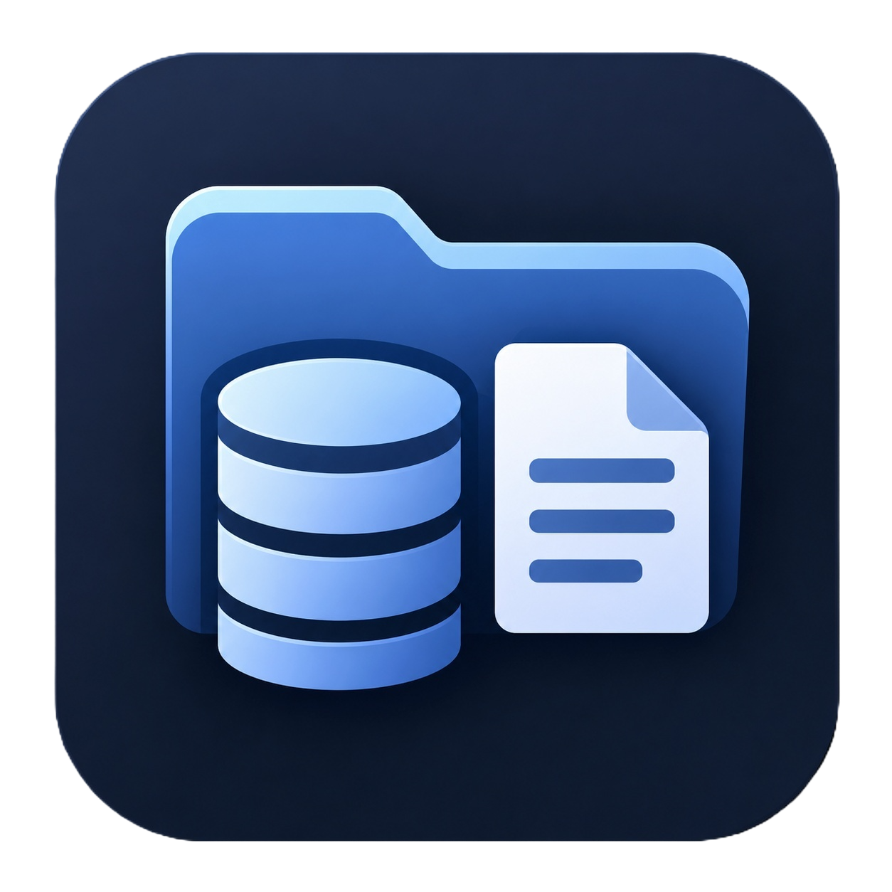
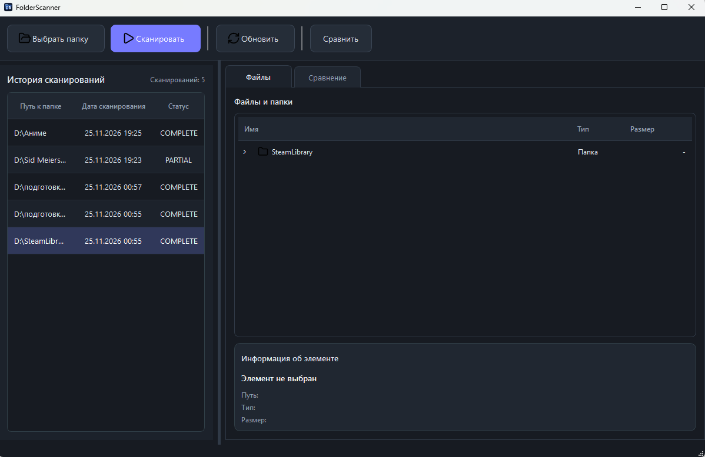
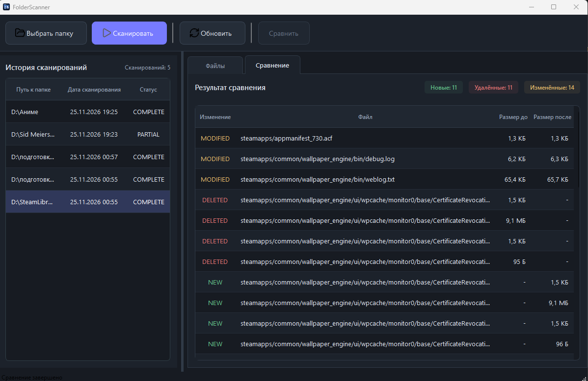

  

<h1 align="center">FileDatabase</h1>

  Desktop-приложение для рекурсивного сканирования файловых каталогов,
  сохранения снимков файловой системы и сравнения их с текущим состоянием.

## О проекте

**FileDatabase** сохраняет состояние выбранной папки в виде снимка: приложение рекурсивно обходит каталоги, собирает сведения о файлах и папках и записывает результат в SQLite. В дальнейшем сохранённый снимок можно открыть, изучить в виде дерева или сравнить с актуальным содержимым исходной папки.

Проект разработан на **C++17 и Qt 6 Widgets**. Интерфейс построен программно, без Qt Designer. Для отображения данных используются модели Qt Model/View, а длительные операции вынесены из GUI-потока.

## Возможности

**Рекурсивное сканирование.** Обход выбранной папки и вложенных каталогов.

-**Сохранение снимков.** Запись пути, даты и времени сканирования, структуры файловой системы и размеров файлов в SQLite.

-**История сканирований.** Просмотр ранее сохранненых снимков и повторная загрузка выбранного состояния.

-**Дерево файлов** Иерархическое представление папок и фалов с именем, типом и размером.

-**Информация об элементе.** Для файла отображается его размер; для папки - количество файлов и суммарный размер содержимого.

-**Сравнение снимка с текущей папкой.** Поиск новых, удаленных и изменненых по размеру файлов.

-**Обработка неполных сканирований.** Ошибки доступа сохраняются отдельно, а неполный снимок не используется для неподтверждённых выводов об удалении файлов.

-**Неблокирующие длительные операции.** Сканирование, сравнение и подготовка больших снимков выполняются в рабочем потоке, чтобы интерфейс оставался отзывчивым.

## Интерфейс

Главное окно состоит из панели истории и рабочей области. В рабочей области доступны вкладки просмотра файлового дерева и результатов сравнения.

Панель сравнения:

## Базовый сценарий работы:

1. Нажми **"Выбрать папку"** и укажи каталог для сканирования.
2. Нажми **"Сканировать"**. Приложение обойдет файловую систему и сохранит снимок.
3. Выбери снимок в панели истории, чтобы открыть его дерево.
4. Выбери файл или папку в дереве, чтобы посмотреть сведения о нем.
5. Нажми **"Сравнить"**, чтобы изучить новые, удаленные и измененные файлы.

Статусы сканирования:
- `COMPLETE` — обход завершился без ошибок.
- `PARTIAL` — часть элементов не удалось прочитать.
- `FAILED` — корневой каталог не удалось просканировать.

**Особенности алгоритма:**

-Сравниваются файлы; пустые и непустые каталоги сами по себе не формируют записи об изменениях.

-Переименование файла отображается как `DELETED` для старого пути и `NEW` для нового.

-Изменение содержимого файла при неизменном размере не обнаруживается: контрольные суммы содержимого не расчитываются.

-Символические ссылки пропускаются и фиксируются в списке ошибок сканирования.